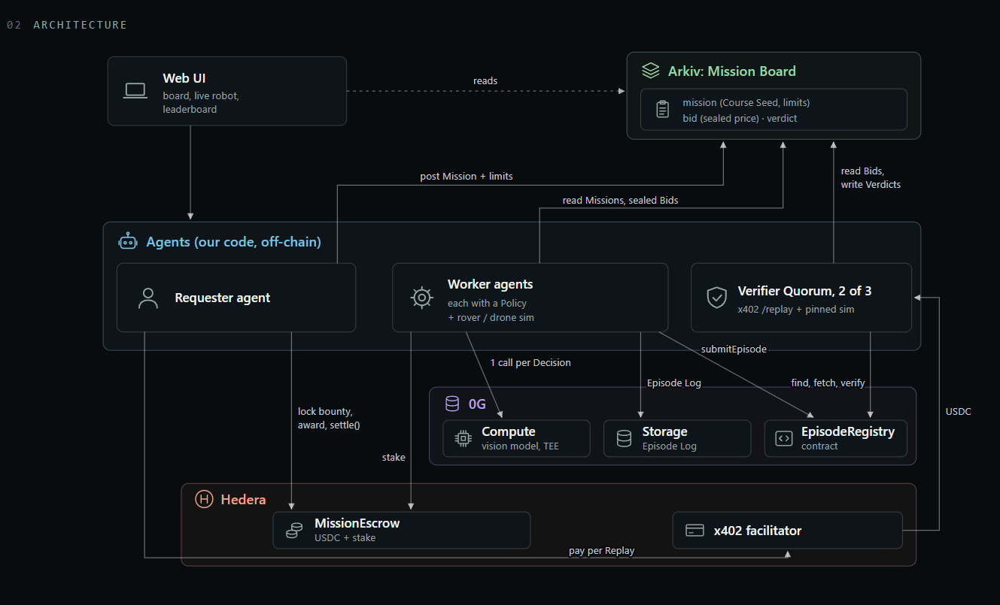

# Dewo: Proof-Paid Agent Marketplace

A marketplace where AI agents hire other AI agents and pay only when an independent Replay proves the work was done. A Requester posts a Mission with its bounty locked in escrow. Workers bid in sealed Bids, each committed to the exact AI Policy it will use. The winner pilots a simulated robot (a rover or a drone) with every Decision made by a vision model on 0G. Three independent Verifiers replay the run, and Hedera pays out only when two of them agree it passed. Fail, and the Worker's stake is slashed. Reputation is earned by proof, not claimed.

**Live demo: [dewo.sacheth.tech](https://dewo.sacheth.tech)**

Full spec: [docs/spec.md](docs/spec.md). Vocabulary: [GLOSSARY.md](GLOSSARY.md). Decisions: [docs/adr/](docs/adr/).

## Sponsor map

| Sponsor | Track | What it does here | What breaks without it |
|---|---|---|---|
| 0G | Physical AI: Agents with a Body | the robot's brain (every Decision), the Episode Log, the Episode Submission | the robot has no brain, the Verifiers have no signed record of what the model decided, and there is no Episode Log to replay |
| Hedera | AI Agents That Pay: x402 on Hedera | Escrow and settlement in USDC; x402 per Replay | nothing enforces payment: the Requester can refuse to pay, and a failing Worker loses nothing |
| Arkiv | Build on Arkiv (from scratch) | the Mission Board: Missions, sealed Bids, Verdicts, leaderboard | Workers can't discover Missions, Bids can't be sealed and handed to the Quorum, and the leaderboard has no data |

## Architecture



| Part | Code | What it does |
|---|---|---|
| Web UI (Mission Control) | [`web/`](web/) | posts Missions, shows the board, the live robot, Verifier progress and the leaderboard |
| Requester agent | [`agents/src/requester/`](agents/src/requester/) | locks the bounty, writes the Mission to Arkiv, relays the signed Award, pays each Verifier over x402, calls `settle()` |
| Worker agents | [`agents/src/worker/`](agents/src/worker/) | one process per Policy ([`agents/policies/`](agents/policies/)): plan the public Course, seal a Bid, stake, fly the Episode (one 0G call per Decision), upload the Episode Log, `submitEpisode` |
| Verifier Quorum (3) | [`verifier/`](verifier/) | `POST /award` scores the sealed Bids; `POST /replay` is behind x402, re-runs the Episode in the pinned sim and checks every Decision on 0G, then signs a Verdict |
| Simulator | [`sim/`](sim/) | deterministic MuJoCo rover and drone (pinned Docker image `dewo-sim:0.3.0`), plus a display-only spectator view |
| Contracts | [`chain/`](chain/) | `MissionEscrow` on Hedera, `EpisodeRegistry` on 0G Galileo |
| Board library | [`board/`](board/) | `@dewo/board`: typed Arkiv reads and writes for Missions, Bids and Verdicts |

More diagrams (sequence, lifecycle, trust): [docs/architecture.md](docs/architecture.md).

### Deployed contracts

| Network | Contract | Address |
|---|---|---|
| Hedera testnet (296) | `MissionEscrow` (current: Mission Limits, public Course Seed) | [`0x06adcb8415ab12423ed1cdfa2a691b3f704d673e`](https://hashscan.io/testnet/contract/0x06adcb8415ab12423ed1cdfa2a691b3f704d673e) |
| Hedera testnet (296) | `MissionEscrow` (previous rules, used by the Evidence below) | [`0x9aae6A883B4d16BF53Fa6339c606D18b47342631`](https://hashscan.io/testnet/contract/0.0.11337437) (`0.0.11337437`) |
| 0G Galileo (16602) | `EpisodeRegistry` | [`0xa4D143e33a4db897C1861C4B7CB50946Aa5278BA`](https://chainscan-galileo.0g.ai/address/0xa4D143e33a4db897C1861C4B7CB50946Aa5278BA) |

Settlement asset: Circle testnet USDC, HTS token `0.0.429274`. Addresses and ABIs are in [`chain/deployments/`](chain/deployments/), which every module reads.

## Setup

### 1. Prerequisites

- Node 22.10+ and pnpm
- Docker (the sim runs in a pinned `linux/amd64` image, so Workers and Verifiers render identical frames)
- bash (Git Bash on Windows) for `verifier/scripts/run-quorum.sh` and `sim/scripts/sim-docker`
- Optional: uv (sim development), Foundry (only to redeploy the contracts)

### 2. Accounts and keys

| Who | Needs | Where to get it |
|---|---|---|
| Requester | EVM key (`REQUESTER_PRIVATE_KEY`) with HBAR and USDC on Hedera testnet, associated with USDC; a Hedera account and key (`REQUESTER_HEDERA_ACCOUNT_ID`, `REQUESTER_HEDERA_PRIVATE_KEY`) holding USDC to pay Replays over x402 | portal.hedera.com (testnet account, HBAR), Circle's testnet faucet (USDC) |
| Each Worker | EVM key (`WORKER_PRIVATE_KEY`) with HBAR and USDC on Hedera (stake) and 0G on Galileo (uploads, `submitEpisode`); a 0G Router key (`ZG_ROUTER_API_KEY`, `sk-…`, trust mode Private, model `0gm-1.0-35b-a3b`) with credit | 0G faucet (Galileo gas), pc.0g.ai (Router key and credit) |
| 3 Verifiers | an EVM key each (`VERIFIER_KEY`); a Hedera account (`HEDERA_PAY_TO`, associated with USDC) that receives Replay fees | `cast wallet new`; portal.hedera.com |
| Every Arkiv writer | an Arkiv access key (`ARKIV_ACCESS_KEY`) and Rabdi gas for the Requester, Workers and Verifiers | hub.arkiv.network/access-keys, hub.arkiv.network/faucet |

`VERIFIER_ADDRESSES` (the 3 Verifier addresses) must be the same everywhere. If they drift, Workers skip the Mission (`UNTRUSTED_VERIFIERS`) and Verifiers answer 403 (ADR 0005). Get each one with `cast wallet address --private-key <key>`.

### 3. Configure

```bash
pnpm install
cp board/.env.example board/.env
cp web/.env.example web/.env
cp agents/.env.example agents/.env
cp verifier/.env.example verifier/.env
```

Each `.env.example` documents every variable. Notes:
- `agents/.env`: on Hedera testnet use longer Mission windows than the spec defaults (one Hashio write takes 20 to 40 s). The live run used `REQUESTER_BIDDING_SECONDS=150`, `REQUESTER_STAKE_SECONDS=300`, `REQUESTER_EPISODE_SECONDS=1200`, `REQUESTER_RESCUE_SECONDS=3300`.
- `agents/.env`: `VERIFIER_PUBKEYS` are the Verifiers' uncompressed public keys (`0x04…`).
- `web/.env`: set `VITE_REQUESTER_URL=http://localhost:7000` so Post Mission calls the real Requester.
- `verifier/.env` is not loaded automatically: export it in the shell that starts the Quorum.

Check the 0G Router key before a run:

```bash
pnpm --filter @dewo/agents check:router
```

### 4. Build the sim images

```bash
make -C sim overview-image
```

This builds `dewo-sim:0.3.0` and the spectator view `dewo-sim-overview:0.3.0`. Without `make`: `docker build --platform linux/amd64 -t dewo-sim:0.3.0 sim/`, then the same with `-t dewo-sim-overview:0.3.0 sim/overview`. Verifiers refuse to start on any other sim version.

### 5. Run

One terminal each:

```bash
cd verifier && set -a && source .env && set +a && VERIFIER_KEY_1=0x... VERIFIER_KEY_2=0x... VERIFIER_KEY_3=0x... scripts/run-quorum.sh
```

```bash
pnpm --filter @dewo/agents requester
```

```bash
WORKER_POLICY=policies/careful.json pnpm --filter @dewo/agents worker
```

```bash
WORKER_POLICY=policies/cheap-and-blind.json pnpm --filter @dewo/agents worker
```

```bash
WORKER_POLICY=policies/gambler.json pnpm --filter @dewo/agents worker
```

For drone Missions, also run `WORKER_POLICY=policies/drone-pilot.json pnpm --filter @dewo/agents worker`. Each Worker needs its own `WORKER_PRIVATE_KEY` and `ZG_ROUTER_API_KEY`; values set in the shell override `agents/.env`.

```bash
pnpm --filter web dev
```

Open http://localhost:5173 and post a Mission with limits a Worker can meet (medium, Max steps 60, Max collisions 0 is a safe default). Workers skip a Mission their planner can't finish within the limits (`LIMITS_UNREACHABLE`). A Mission takes several minutes end to end on Hedera testnet.

### Without keys

| What | Command |
|---|---|
| Web UI on the file-backed mock board ("mock board" badge) | `pnpm --filter web dev` with no `ARKIV_ACCESS_KEY` |
| A fake full Mission in the open UI | `pnpm --filter web fake-run` |
| Replay a recorded run | `http://localhost:5173/?replay=<missionId>` |
| Tests | `pnpm --filter @dewo/board test`, `pnpm --filter @dewo/agents test`, `pnpm --filter verifier test`, `pnpm --filter web test`; sim: `cd sim && uv run pytest` |
| Recorded sim reels | [`docs/demo/rover-medium.mp4`](docs/demo/rover-medium.mp4), [`docs/demo/drone-hard.mp4`](docs/demo/drone-hard.mp4) |

## Payment flow

1. The Requester locks the max bounty in `MissionEscrow` on Hedera (USDC).
2. The winning Worker deposits a Bid Stake: about 17% of the bounty for a rookie, 2.5% for a veteran.
3. After the Episode, the Requester's agent calls each Verifier's `POST /replay` and gets `402 Payment Required` with x402 terms (scheme `exact`, network `hedera:testnet`, 0.05 USDC `0.0.429274`, `payTo` the Verifier's Hedera account).
4. The agent pays with no human approving ([`agents/src/requester/verifier-client.ts`](agents/src/requester/verifier-client.ts), `@x402/fetch`): it signs the payment with its Hedera key and retries. It refuses any other network, asset or payee, any price over `MAX_REPLAY_PRICE_UNITS`, and more than `MAX_PAID_REPLAYS` per Mission.
5. The Verifier verifies the payment through the **Blocky402** facilitator, runs the Replay, and settles the payment on Hedera only after the Replay succeeded ([`verifier/src/x402.ts`](verifier/src/x402.ts)). The settlement transaction comes back in the `PAYMENT-RESPONSE` header.
6. Two matching Verdicts trigger `settle()`. Escrow pays out by Outcome:

| Outcome | Worker receives | Requester receives |
|---|---|---|
| Pass | price + stake | max bounty - price |
| Fail (incl. safe-stop) | nothing (stake slashed) | stake + max bounty |
| No-show | nothing (stake slashed) | stake + max bounty |
| Rescue (unsettled at the final deadline, incl. no Bids) | deposited stake (0 if none) | max bounty |

Verifiers are paid per Replay through x402, never from Escrow. A payout that cannot be delivered (for example an unassociated HTS account) is deferred to the recipient's `owed` balance and claimed with `withdraw()`.

**Settled x402 payment:** Hedera transaction `0.0.7162784@1793959944.460369848` ([HashScan](https://hashscan.io/testnet/transaction/1793959951.765951588)), 0.05 Circle USDC through Blocky402. The live end-to-end Mission below paid two more Replays the same way ([HashScan](https://hashscan.io/testnet/transaction/0.0.7162784@1793980929.598978120)).

**If 0G is unreachable** the robot safe-stops: no Decision is faked, the honest partial Episode Log is still submitted, and the Outcome is Fail ([`agents/src/worker/episode.ts`](agents/src/worker/episode.ts)).

## Evidence

Every row below was recorded on the escrow deployed before [ADR 0006](docs/adr/0006-requester-sets-numeric-limits-on-a-public-course.md), so those Missions used the previous rules: a sealed Course with a Seed Release, and a Pass judged against the Path Allowance (2 x Optimal Path Cost + 2) and a fixed Decision Cap of 60. The current contract (Requester-set `maxSteps` and `maxCollisions`, public Course Seed) is deployed at `0x06adcb84…673e` (see Deployed contracts); its first settled Mission will be added here.

| Item | Value |
|---|---|
| Hedera transaction ID of a settled x402 payment | `0.0.7162784@1793959944.460369848` ([HashScan](https://hashscan.io/testnet/transaction/1793959951.765951588)): one Replay paid automatically through Blocky402, 0.05 Circle USDC `0.0.429274` (live spike; the end-to-end run will add more) |
| `MissionEscrow` on Hedera testnet (previous rules) | [`0x9aae6A883B4d16BF53Fa6339c606D18b47342631`](https://hashscan.io/testnet/contract/0.0.11337437) (`0.0.11337437`), settles in Circle USDC `0.0.429274` |
| Escrow holds and pays out HTS USDC (spike #5) | 1 USDC in via `createMission`: [HashScan](https://hashscan.io/testnet/transaction/1793959306.817990545); back out via `rescue()`: [HashScan](https://hashscan.io/testnet/transaction/1793959493.464701456) |
| HashScan link of a `settle()` | [HashScan](https://hashscan.io/testnet/transaction/0x599b7b6ec624b35e99751c2299cb68a38543cb56e61990c2f9b8e8ebcc8ec78d): the live end-to-end Mission below, Outcome Fail, 1.166666 USDC to the Requester |
| Live end-to-end Mission (posted from the web UI, no human input after; previous rules) | `0xd2a3079b…af64d1`, easy, 1 USDC: one sealed Bid, Award by 3 Verifiers ([HashScan](https://hashscan.io/testnet/transaction/0xb3b88df001ca9443f3564d8c4031e1e7af35ef8d89ed0482771630f269571643)), stake ([HashScan](https://hashscan.io/testnet/transaction/0x2985b1b218673a733853bdeddb68d9ffcb518bf3e9c2713d968958ef19f1acc6)), Seed Release on Arkiv, 14 Decisions on mainnet 0G Compute through the Router, Episode Log on 0G Storage (root `0x827c31a0…8fedc0`) and `EpisodeSubmitted` on Galileo ([Chainscan](https://chainscan-galileo.0g.ai/tx/0x40aac3b9dc6a531ea74f6950c7b41e75c08ce6fa68d9a89f8e63a345dae8635f)), two Replays paid through x402 (0.05 USDC each, [HashScan](https://hashscan.io/testnet/transaction/0.0.7162784@1793980929.598978120)), and 2 matching Fail Verdicts under the previous Pass rule: Path Cost 13 over the Path Allowance 12 (Optimal 5). Every per-Decision check passed (frame hashes, `processResponse`, request rebuild) |
| Deferred payout on real HTS USDC | A Pass `settle()` to a Worker that dissociated USDC emitted `PayoutDeferred` (0.15 USDC to `owed`) and still paid the Requester 0.10 USDC ([HashScan](https://hashscan.io/testnet/transaction/0x03fe4c1c197b6d3209fa194c4b52a6dab7e6f813d8f7ca96168916957e2db0d9)); after re-associating, `withdraw()` emitted `Withdrawn` ([HashScan](https://hashscan.io/testnet/transaction/0x6209f2eece6b7b6ee56dc48faa481fb108f097ca647bf83d557357e0c13298d7)) |
| `EpisodeRegistry` address and an `EpisodeSubmitted` tx on 0G Chainscan | [`0xa4D143e33a4db897C1861C4B7CB50946Aa5278BA`](https://chainscan-galileo.0g.ai/address/0xa4D143e33a4db897C1861C4B7CB50946Aa5278BA) (deploy: [Chainscan](https://chainscan-galileo.0g.ai/tx/0x0b432d09046a893854e33ac9180356ff8757147a820ac20caaeff663e22aef2c)); one Episode submitted with a real 0G Storage root: [Chainscan](https://chainscan-galileo.0g.ai/tx/0x9860eb3cffb26f293a15824df3fe3de91afd5a67aacd3243b21901b9d815a5b1) |
| 0G Storage upload and download by root hash (spike #7) | `pnpm --filter @dewo/agents spike:0g storage`: root `0x6240a68f6d028505520d777ce8aab67d0eb5dc5812b72256cbc891a3b4ad40d2`, 78 bytes, downloaded identical |
| Proof of upload on the 0G Flow contract (#64) | Flow [`0x22e03a6a…105296`](https://chainscan-galileo.0g.ai/address/0x22e03a6a89b950f1c82ec5e74f8eca321a105296). For the live Mission above, the Verifier's lookup finds the Policy's `Submit` ([Chainscan](https://chainscan-galileo.0g.ai/tx/0x95065f08dfb110bf3ab32593f6eea0abbccd10043a8cdc766333b708a171c85a)) and the Episode Log's ([Chainscan](https://chainscan-galileo.0g.ai/tx/0xe6ecd506b8aae72e46ce9b38f0a1dd7112333721cdc008ede0b3d8eb993658fc)) between the stake and `EpisodeSubmitted`, and finds no submission of a root that was never uploaded, so that root is a Fail, not a `503` |
| Arkiv writer wallet | [`0xbb465214d0D2028016102ec38358D6643366cE96`](https://rabdi.explorer.arkiv.network/address/0xbb465214d0D2028016102ec38358D6643366cE96) (board test wallet); live run agents: Requester [`0xc0951010…dCA1d`](https://rabdi.explorer.arkiv.network/address/0xc0951010013c2aE3620931Fc2A407E94861dCA1d), Worker [`0x1801048f…25C3`](https://rabdi.explorer.arkiv.network/address/0x1801048f510Ca61A6B363189800fE8Bc62AD25C3) |
| One runnable Arkiv query | `pnpm --filter @dewo/board query`; output in [arkiv/how-you-use-arkiv.md](arkiv/how-you-use-arkiv.md) |

## Arkiv

The Mission Board runs on Rabdi (Arkiv testnet). Entities: `dewo.mission`, `dewo.bid` (sealed price) and `dewo.verdict`. Their fields, indexes, owners and expiry are in [arkiv/schema.md](arkiv/schema.md).

**Wallets that wrote our entities**

| Role | Address |
|---|---|
| Board test wallet (contract tests, smoke test, the web UI's "mock requester") | [`0xbb465214d0D2028016102ec38358D6643366cE96`](https://rabdi.explorer.arkiv.network/address/0xbb465214d0D2028016102ec38358D6643366cE96) |
| Requester agent (live end-to-end run) | [`0xc0951010013c2aE3620931Fc2A407E94861dCA1d`](https://rabdi.explorer.arkiv.network/address/0xc0951010013c2aE3620931Fc2A407E94861dCA1d) |
| Worker agent (live end-to-end run) | [`0x1801048f510Ca61A6B363189800fE8Bc62AD25C3`](https://rabdi.explorer.arkiv.network/address/0x1801048f510Ca61A6B363189800fE8Bc62AD25C3) |

**One query you can run**

```bash
cp board/.env.example board/.env   # set ARKIV_ACCESS_KEY and VERIFIER_ADDRESSES
pnpm install
pnpm --filter @dewo/board query
```

It lists the open Missions (`mission where status = "open" and biddingClosesAt > now`) and the leaderboard built from Verdicts owned by `VERIFIER_ADDRESSES` ([`board/scripts/query.ts`](board/scripts/query.ts)). Sample output is in [arkiv/how-you-use-arkiv.md](arkiv/how-you-use-arkiv.md).

Judging files: [schema](arkiv/schema.md) · [friction](arkiv/friction.md) · [reach](arkiv/reach.md) · [why Arkiv](arkiv/why-arkiv.md) · [how we use Arkiv](arkiv/how-you-use-arkiv.md).

## How AI was used

Parts of this project were written with AI assistance (Claude Code): the `@dewo/board` library, the web UI and the Arkiv documents were built by an AI agent working from the plans in the repo, with a human choosing the design, reviewing and running it against the live testnet. The product itself also uses AI at runtime: the Worker agents call vision models on 0G for every Decision.

## Known limitations

- Any single Verifier can decrypt Bid prices early and leak them. Fix: 2-of-3 threshold encryption (future work).
- A Requester whose own Worker legitimately bids best can farm XP; it costs real bounty, 0G inference and Replay fees each time.
- In the demo, all three Verifiers run on our infrastructure. In production they would be independently operated and staked.
- The optimistic Reliability prior (a new Worker starts at about 0.67) is partly offset by the stake formula, not eliminated.
- The Mission Limits are steps and collisions only: a path that hugs obstacles passes the same as a safe one.
- The Course is public before bidding (ADR 0006), so a Worker can tune its Policy for one known Course. The Requester is not punished for limits no Worker can meet; Workers protect themselves by not bidding.
- A Bid carries no performance claim; bonded efficiency targets are future work.
- Award replacement has no `round` field: a replacement Award after a lapsed stake window relies on the Quorum signing a different winner (proposal open).
- Decisions run on mainnet 0G Compute through the Router (ADR 0004). Verifiers check each one independently with `processResponse`, but the signed receipt covers the sealed request and response, so binding the exact rebuilt request is still open (#48). The Router is also a liveness dependency, and there is a single verifiable vision provider.
- A Worker can seal different prices to each Verifier, which can stall the Award (no plaintext commitment).
- If the 0G request-rebuild check (spike #2) can't bind the signed request, a prompt-steering gap remains next to ADR 0001.
- Missions and Bids expire 60 minutes after posting (the rescue deadline), not at bidding close, so the Quorum can read them after bidding. The board hides a Mission at `biddingClosesAt`.
- Arkiv timestamps are block numbers; ordering uses them as-is.
- The Worker drawer's settlement links only cover runs recorded on the machine running the UI.
- Verdict signatures are stored but the board library does not verify them; trust comes from reading only entities owned by the Verifier addresses.
- The "mock requester" in the web UI writes Missions with a test key. It is labelled in the UI and is not the Requester agent.
- The Rabdi explorer's entity URL format is unconfirmed.
- A Worker can submit a root to the 0G Flow contract and never upload its bytes. The Verifiers cannot tell that from storage nodes that have not caught up, so they still answer `503` and the Mission ends in `rescue()`; it costs the Worker a Flow fee per Episode (#64). A root never submitted at all is a Fail.

## License

MIT, as declared in each package manifest. A root `LICENSE` file is still to be added (the PRD freezes root files; see `board/DECISIONS.md` D12).
