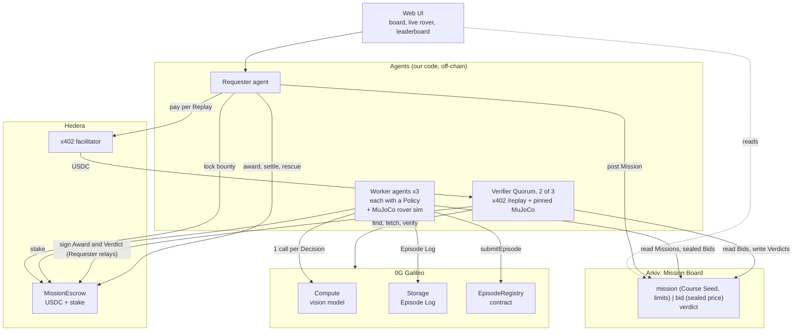
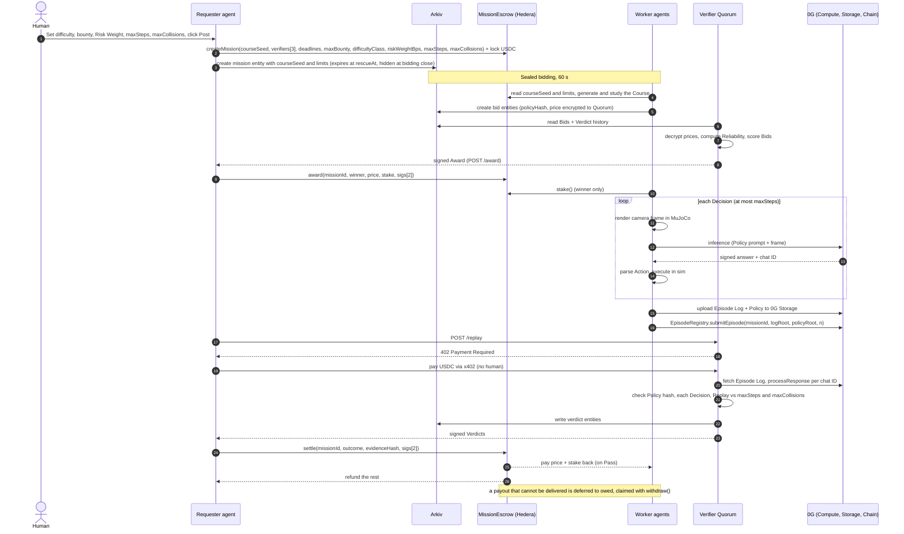
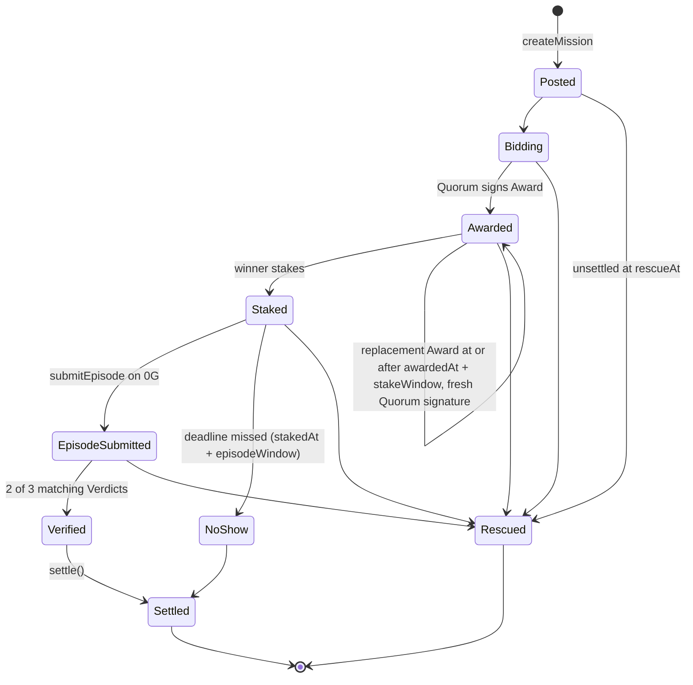
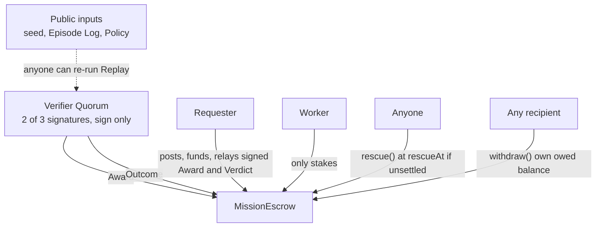

# Architecture

Diagrams for the Proof-Paid Agent Marketplace. The full design is in `docs/spec.md`, and the terms are defined in `GLOSSARY.md`.

## 1. System components

What runs where, and which sponsor each part touches.

## 2. One Mission, end to end

## 3. Mission lifecycle

Outcomes reaching `Settled`: Pass, Fail, No-show. The payout for each is in `docs/spec.md` section 4.4. A Mission still unsettled at `rescueAt` (including one with no Bids) can be rescued: the Requester gets `maxBounty` back and a staked Worker its stake. Settlement is blocked from `rescueAt`. A payout the recipient cannot receive is deferred (`owed`, `PayoutDeferred`) and claimed with `withdraw()`.

## 4. Who trusts whom

